<!-- ===================== HEADER ===================== -->


 

 

<a href="#about">About</a> · <a href="#stack">Stack</a> · <a href="#experience">Experience</a> · <a href="#softlaunch">SoftLaunch</a> · <a href="#projects">Projects</a> · <a href="#certs">Certifications</a> · <a href="#connect">Connect</a>

## 🕷️ About Me


 


## 🕸️ Tech Stack


  


## 🕷️ Experience


## 🕸️ Spotlight: [SoftLaunch](https://github.com/Nayeemshaik29/softlaunch) 💘

<a href="https://github.com/Nayeemshaik29/softlaunch"></a>

### 🏗️ Architecture

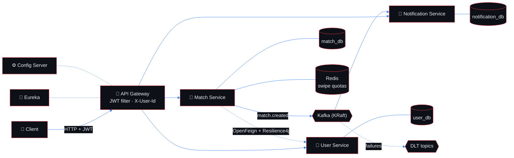

### ⚙️ Engineering Highlights

| Area | What I built | Why it matters |
|:--|:--|:--|
| 🔐 **Gateway security** | Global JWT filter that forwards `X-User-Id` and **strips client-supplied headers** | Stops identity spoofing; `/internal/**` routes are never exposed |
| ⏱️ **Auth hardening** | **Constant-time login** with a dummy hash check for unknown emails | Blocks timing-based user enumeration |
| 💞 **Race-safe matching** | Matches stored as a **sorted user pair** with a unique DB constraint | A↔B and B↔A can never create duplicate matches |
| 🚦 **Rate limiting** | **Redis `INCR` + TTL** daily swipe quota | Returns `429` when the quota runs out, and scales across instances |
| 🛡️ **Fault tolerance** | **OpenFeign + Resilience4j** circuit breaker and time limiter | Match Service keeps working when User Service is slow |
| 📨 **Event-driven** | Kafka `match.created` events with **idempotent consumers, retries and DLT** | No lost or duplicate notifications |
| 🧾 **Clean APIs** | **RFC 9457 `ProblemDetail`** errors, Bean Validation, a custom `@Adult` validator | Consistent errors and 18+ enforcement at the edge |
| 🗃️ **Data ownership** | **Database per service** (PostgreSQL 17) | Services stay independent and deploy separately |

<b>🗺️ Roadmap: 5 of 10 phases done</b>

 

| Phase | Scope | Status |
|:--:|:--|:--:|
| 1 | Eureka, Config Server, API Gateway | ✅ |
| 2 | User Service: signup/login, BCrypt, JWT, rich profiles | ✅ |
| 3 | Gateway security: JWT filter, header anti-spoofing | ✅ |
| 4 | Match Service: swipes, matching, Redis quota, Feign + circuit breaker | ✅ |
| 5 | Kafka events, Notification Service, idempotency, retries + DLT | ✅ |
| 6 | Discovery: Redis GEO nearby feed + gRPC | 📋 |
| 7 | Chat: WebSocket/STOMP, MongoDB, disappearing messages | 📋 |
| 8 | Verification (18+ KYC mock) and safety (report/block) | 📋 |
| 9 | Observability: Zipkin, Prometheus, Grafana | 📋 |
| 10 | AI assistant: openers and scam detection (Ollama + pgvector) | 📋 |

## 🕷️ More Projects


<b>📚 Learning and reference repos (click to expand)</b>

 

| Repo | What's inside |
|:--|:--|
| 🗃️ [Database-Optimization](https://github.com/Nayeemshaik29/Database-Optimization) | 18 techniques (indexing, partitioning, sharding, replication) with diagrams |
| 🧠 [Interview-DSA-Playbook](https://github.com/Nayeemshaik29/Interview-DSA-Playbook) | Pattern-based Java DSA prep with dry runs and complexity analysis |
| 🎨 [Design_Patterns](https://github.com/Nayeemshaik29/Design_Patterns) | Design patterns in Java using real-world scenarios |
| 📨 [kafka-learning-spring-boot](https://github.com/Nayeemshaik29/kafka-learning-spring-boot) | Kafka producer and consumer exchanging location events |
| 🧱 [object-oriented-programming](https://github.com/Nayeemshaik29/object-oriented-programming) | OOP guide from beginner to expert, interview-focused |

## 🕸️ Certifications


## 🕷️ GitHub Activity


### 🧠 LeetCode

## 🕸️ Let's Connect

<a href="https://nayeem-shaik.vercel.app"></a>

